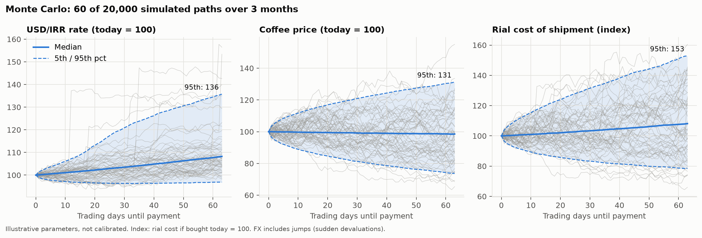
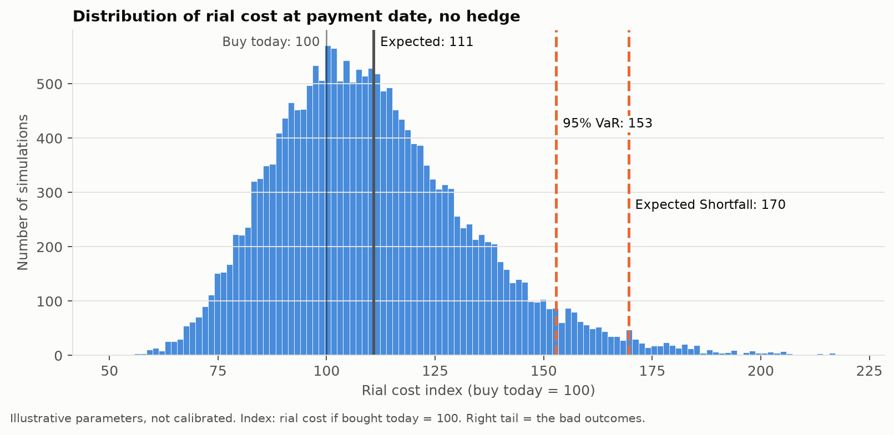
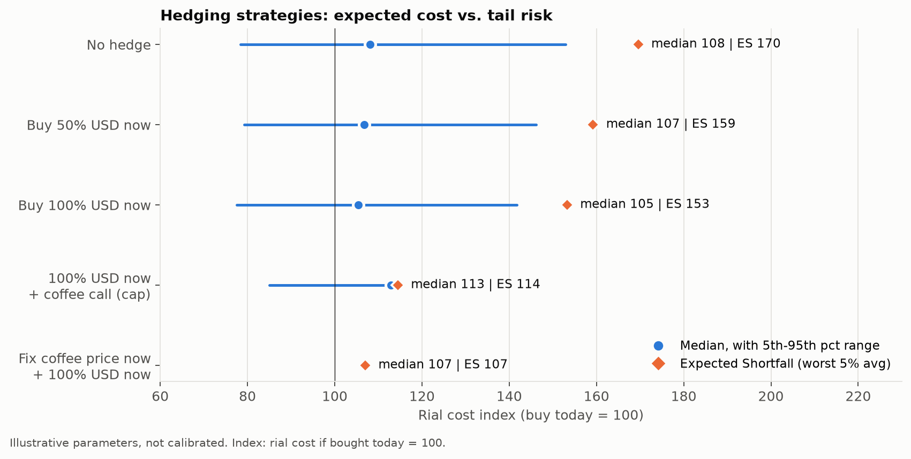
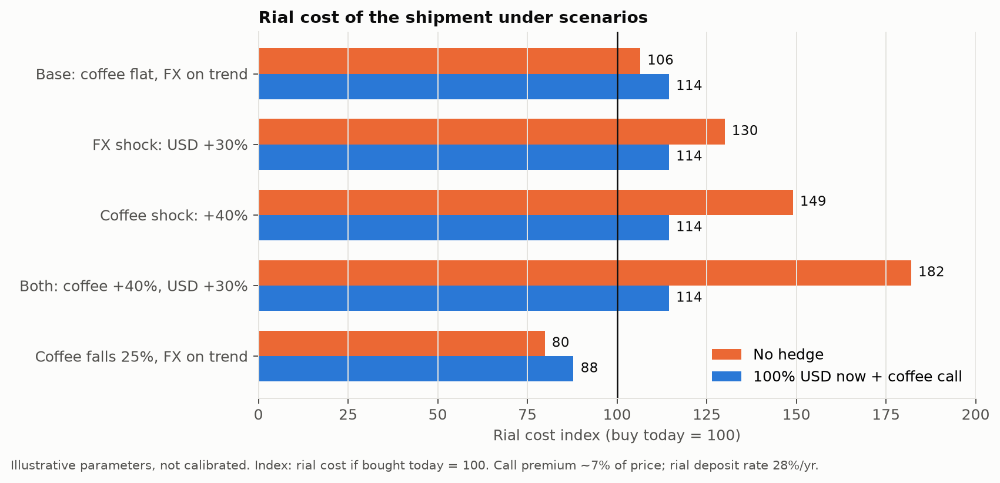

# FX & Commodity Hedging for an Importer

An importer has to pay **$100k for a coffee shipment in 3 months**, and its revenue is in Iranian rial.
The question isn't "where will the dollar go?". The question is **what range the rial cost of this shipment can fall
in, and which decision today narrows that range most cheaply.**

The rial cost decomposes into two separate risks, each with its own lever:

$$C_{IRR} = Q \,\bigl(P_{ICE}(t_1) + D\bigr)\, S(t_2) + F + T$$

- **Commodity risk:** the arabica reference price $P_{ICE}$ plus the quality/origin differential $D$, fixed at time $t_1$.
- **FX risk:** the USD/IRR rate $S$, paid at time $t_2$.

## Model

- **Coffee:** geometric Brownian motion (35% annual vol).
- **USD/IRR:** drift + **jump-diffusion**. The rial depreciates steadily and also has sudden devaluations that a
  normal distribution underweights (25%/yr trend, about one 15% jump per year).
- 20,000 Monte Carlo paths over 63 trading days. Results are an index where *buying everything today = 100*.
- Hedging cost is included: buying USD early forgoes a 28% rial deposit rate, and an ATM coffee call (Black-76) costs about 7%.

> Parameters are illustrative, chosen to demonstrate the method, not calibrated to data.

## Results

| Strategy | Median | 95% VaR | Expected Shortfall |
|---|---|---|---|
| No hedge | 108 | 153 | **170** |
| Buy 50% USD now | 107 | 146 | 159 |
| Buy 100% USD now | 105 | 142 | 153 |
| 100% USD now + coffee call | 113 | 115 | **115** |
| Fix coffee price + 100% USD now | 107 | 107 | 107 |

**Takeaway:** buying FX early on its own barely moves the tail (ES 170 → 153), because coffee risk stays open.
Adding a coffee call caps the tail at about 115 for about 7% in normal times. Fixing the price with the supplier
(fixed-price or PTBF contract) is cheaper still.






## Beyond the model

- **Net exposure:** if the importer can pass cost increases into sale prices quickly, the true exposure is smaller
  than $100k. Only the part that can't be passed through needs hedging.
- **No USD/IRR derivatives exist,** so a proxy hedge is calls on gold funds on the Iran Mercantile Exchange
  (rial gold ≈ global gold × USD/IRR). This adds gold-price and basis risk, and the hedge ratio should be estimated from history.
- **Risk limits become constraints:** for example, P(cost > liquidity + credit line) ≤ 5% and P(stock-out before arrival) ≤ 10%.
  Pick the cheapest strategy that satisfies both.
- **Validation:** backtest the 3-month 95% bands on past data. If they break more than 5% of the time, the jump model underestimates the tails.

The full write-up (Persian) is in [docs/writeup_fa.pdf](docs/writeup_fa.pdf).

## Run

```bash
pip install -r requirements.txt
python simulate.py          # writes figures/ and prints the table above
```
